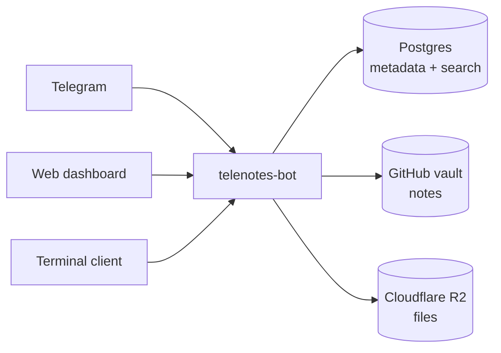

# telenotes

**Capture notes and files from your phone into storage you own — via
Telegram, a web dashboard, or a terminal.**

[](https://github.com/Jayinaksha/telenotes/actions/workflows/bot-ci.yml)
[](https://github.com/Jayinaksha/telenotes/actions/workflows/pages.yml)
[](LICENSE)
[](../../discussions)

Send a Telegram message and it's a searchable note. Send a PDF, photo, voice
memo, or video and it's archived. Tag anything with `#like-this`. Browse,
search, edit, and see stats from the web dashboard or a terminal client —
built to run entirely on free-tier infrastructure, with your data landing in
storage *you* control, not a vendor's database.

## Why this exists

Most "quick capture" tools either lock your notes into their own service or
ask you to self-host something heavyweight. telenotes takes a third path:
Telegram as the always-available capture surface (it's already on your
phone, it's fast, it handles every media type), a thin Rust bot as the only
thing that touches your credentials, and storage split across systems
that are actually good at the job — markdown notes in a git repo you own,
binary files in object storage, metadata in Postgres for search. Nothing
proprietary holds your data hostage.

## Features

- **Capture from anywhere** — Telegram (text, PDFs, photos, voice, video),
  the web dashboard, or the TUI all write through the same bot.
- **Full-text and semantic search** — Postgres full-text search out of the
  box; optional embeddings-based "related items" and meaning-based search
  via Voyage AI.
- **Tags**, extracted automatically from `#hashtags` in text or captions.
- **Markdown + LaTeX rendering** for notes and `.md` uploads, in the web
  dashboard and (markdown, sans LaTeX) the TUI.
- **Stats** — activity over time, storage breakdown by kind and backend.
- **Your data, your storage** — notes as diffable markdown in a GitHub repo
  you control; files in Cloudflare R2 (or the same GitHub repo if you skip
  R2). Nothing lives in a vendor-specific database export format.
- **Runs on free tiers** — Render, GitHub Pages, Supabase, and Cloudflare
  R2 all have free plans generous enough for personal use.

## How it fits together



One bot is the only thing that ever holds a GitHub token, an R2 key, or any
other credential — every client reaches those systems by asking it, never
directly. See **[architecture.md](architecture.md)** for the full picture:
the auth model, the capability-token flow behind writes and downloads, and
why storage is split the way it is.

## Project layout

```
telenotes-bot/     the bot (Rust, webhook mode) and its /api/* write endpoints
telenotes-core/    shapes and pure text helpers shared by the bot and the TUI
telenotes-tui/     a terminal client for browsing, searching, and capturing
web/               the dashboard, published to GitHub Pages
.github/workflows/ CI for the Rust workspace, a Supabase keepalive ping, and the Pages deploy
```

| Component | Docs |
| --- | --- |
| [`telenotes-bot/`](telenotes-bot/) | [README](telenotes-bot/README.md) · [SETUP.md](telenotes-bot/SETUP.md) |
| [`telenotes-core/`](telenotes-core/) | shared types/helpers, no separate docs |
| [`telenotes-tui/`](telenotes-tui/) | see the root [SETUP.md §7a](telenotes-bot/SETUP.md) |
| [`web/`](web/) | see the root [SETUP.md §7](telenotes-bot/SETUP.md) |

## Tech stack

| Piece | What it does |
| --- | --- |
| Rust + [teloxide](https://github.com/teloxide/teloxide) / [axum](https://github.com/tokio-rs/axum) | The bot, in webhook mode |
| [ratatui](https://ratatui.rs) | The terminal client |
| [Supabase](https://supabase.com) Postgres | Metadata, tags, full-text + vector search |
| Supabase Auth + Row Level Security | Login and per-row access control for the dashboard/TUI |
| A private GitHub repo | Notes, stored as markdown |
| [Cloudflare R2](https://developers.cloudflare.com/r2/) *(optional)* | Binary files |
| [Voyage AI](https://www.voyageai.com) *(optional)* | Embeddings for semantic search |
| [Render](https://render.com) free web service | Hosting the bot |
| GitHub Pages | Hosting the dashboard |

## Getting started

Full setup is one document: **[telenotes-bot/SETUP.md](telenotes-bot/SETUP.md)**.
It walks through the Telegram bot, the GitHub vault repo, Supabase, Render
deployment, and the optional pieces (R2, the dashboard, the TUI, Notion,
semantic search) — the required path is about 20 minutes; everything after
step 6 is opt-in.

```bash
git clone https://github.com/Jayinaksha/telenotes
cd telenotes
cargo build --workspace
```

Then follow SETUP.md from step 1.

## A note on visibility

This repository is source-available under the Apache License 2.0, but the
data it captures never lives here. The web dashboard's *published site* is
public regardless of this repo's own visibility — that's deliberate; it
ships nothing but a Supabase anon key and leans entirely on Row Level
Security. Actual secrets (bot tokens, storage credentials, database URLs)
only ever exist as environment variables on your own Render deployment,
never committed. See [SECURITY.md](SECURITY.md) for the full trust model
and how to report a vulnerability.

## Contributing

See [CONTRIBUTING.md](CONTRIBUTING.md) for how to propose a change, the
checks CI runs, and the project's code style. Bug reports and ideas are
welcome as [issues](../../issues); open-ended questions fit better in
[Discussions](../../discussions).

This project follows a [Code of Conduct](CODE_OF_CONDUCT.md).

## License

Apache License 2.0 — see [LICENSE](LICENSE) and [NOTICE](NOTICE).

---

Extracted from [`Jayinaksha/reflect`](https://github.com/Jayinaksha/reflect)
(commit `c4cfe14`), where it had been sharing a repo with unrelated UAV/HRLLC
research.
