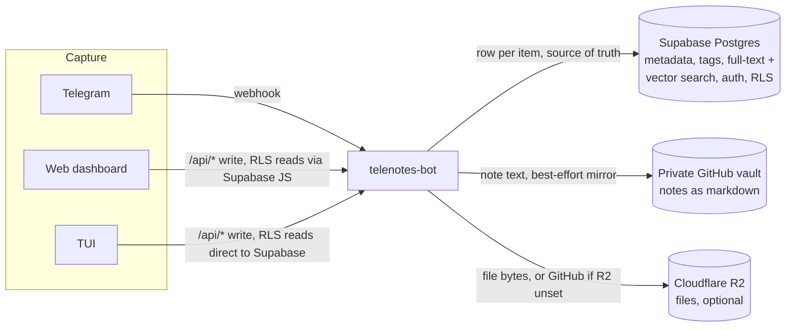
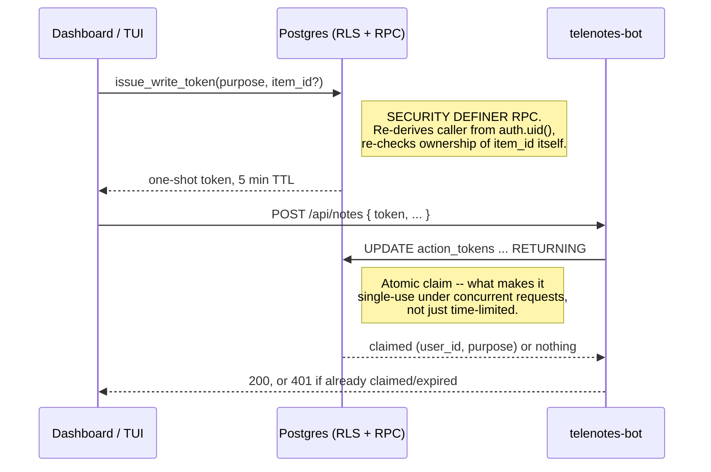

# Architecture

This is the system-level view: what talks to what, why storage is split the
way it is, and how the three clients (Telegram, the web dashboard, the TUI)
end up sharing one bot and one Postgres schema without duplicating logic.
For a component's own internals, see its README —
[`telenotes-bot`](telenotes-bot/README.md) has the deepest one.

## Components

| Component | Language | Role |
| --- | --- | --- |
| [`telenotes-bot`](telenotes-bot/) | Rust (axum + teloxide) | The only thing that talks to Postgres, GitHub, R2, Notion, or Voyage AI directly. Runs both the Telegram webhook handler and the `/api/*` HTTP surface the dashboard and TUI use. |
| [`telenotes-core`](telenotes-core/) | Rust | Shared `Item`/`Stats` types and pure text helpers (`extract_tags`, `slugify`, `sanitize`), used by the bot and the TUI so both parse and format the same way. |
| [`telenotes-tui`](telenotes-tui/) | Rust (ratatui) | Terminal client. Talks to Supabase directly for reads (through RLS) and to the bot for anything that needs a secret the client shouldn't hold. |
| [`web`](web/) | Vanilla JS, no build step | Browser dashboard, published to GitHub Pages. Same client/bot split as the TUI. |

No component other than the bot ever sees a GitHub token, an R2 key, a
Notion token, or a Voyage API key. That's not a convention — it's enforced
by which credentials each deployment target even has.

## Where data lives, and why

**Notes go to GitHub as markdown.** Text you want to keep is exactly what
git is good at: readable, diffable, versioned, greppable outside the app
entirely. Postgres holds the authoritative copy; the markdown file is a
best-effort mirror, so a GitHub hiccup never blocks saving a note.

**Files go to R2.** Git is exactly wrong for binaries — every upload is a
commit, and deleting a file only unlinks it from the branch tip; the blob
stays in history and counts against the repo forever. R2 has no such
problem, gives 10GB free, and charges nothing for egress. R2 is optional:
leave the `R2_*` environment variables unset and files fall back to the
GitHub vault, and everything still works, just without the "don't bloat git
with binaries" property.

**Postgres is the index over both**, plus the only thing any client
queries directly (through RLS) for reads — search, tags, stats, and
semantic search all run as RPCs against it. Neither GitHub nor R2 is ever
queried for anything other than "give me these exact bytes."

## Why one bot, three clients

The `/api/*` handlers in `telenotes-bot` and the Telegram command handlers
both call into the same functions in `handlers.rs` — there is exactly one
code path for "create a note" or "delete an item," not three. Telegram,
the dashboard, and the TUI are just three ways to invoke it. This is also
why credentials for GitHub/R2/Notion/Voyage only ever need to exist in one
place (the bot's environment on Render): every other surface reaches those
systems by asking the bot, never directly.

## Auth model

Two different trust boundaries, because the dashboard/TUI and Telegram
prove identity in different ways:

- **Telegram** — the bot registers a webhook secret with Telegram
  (`set_webhook`) and checks it against the `X-Telegram-Bot-Api-Secret-Token`
  header on every delivery. `ALLOWED_CHAT_IDS` gates writes before any
  database access, so an unrecognized chat can't create a user row at all.
- **Dashboard/TUI** — Supabase Auth (magic-link email) plus Postgres Row
  Level Security. The bot **never verifies a Supabase JWT** — Postgres
  already did that check before minting any capability token, so the token
  itself *is* the authorization for whatever it names.

### Capability tokens

Reads (search, tags, stats, related items) go straight from the client to
Postgres through RLS — no bot involved. Anything that needs a secret the
client can't hold (a write, a download URL, an embedding for semantic
search) goes through a short-lived, single-purpose token instead of a
session credential:

The same shape covers downloads (`issue_download_token`, redeemed at
`GET /d/{token}`) and semantic search (reuses the write-token machinery
with `purpose = 'semantic_search'`, since embedding a query needs the
Voyage API key). In every case, Postgres — not the bot, not the client —
is what decided whether the request was allowed, at the moment the token
was minted.

## Semantic search

Every note and PDF gets chunked and embedded (Voyage AI) into a `chunks`
table alongside a `pgvector` HNSW index. Two RPCs read it:

- `related_items(item_id)` — nearest-chunk cosine distance, `SECURITY
  INVOKER` + RLS, no bot involved (it's a pure read of your own rows).
- Free-text semantic search — embedding the *query* string needs the
  Voyage key, so that step (and the `pgvector` query after it) happens
  bot-side in `POST /api/semantic-search`, behind a token exactly like a
  write.

This is entirely optional. Skip the setup in `telenotes-bot/SETUP.md` and
every other feature works exactly as before.

## Deployment topology

| Piece | Where | Notes |
| --- | --- | --- |
| `telenotes-bot` | [Render](https://render.com), free web service | Docker build from the repo root (needs the whole workspace for the `telenotes-core` path dependency). Sleeps after 15 min idle on the free tier. |
| `web/` (dashboard) | GitHub Pages | Static files, no server. Public regardless of the repo's own visibility — see the note in the root README. |
| Postgres, Auth | [Supabase](https://supabase.com), free tier | Schema and RLS policies live in `telenotes-bot/migrations/`. |
| Notes vault | A separate private GitHub repo | Not this repo — see `telenotes-bot/SETUP.md` step 2. |
| Files | Cloudflare R2, optional | 10GB free, no egress charges. |
| CI | GitHub Actions | `cargo fmt`/`clippy -D warnings`/`test` on any push touching the Rust workspace; a separate workflow deploys `web/` to Pages. |

Nothing here requires a paid tier to run continuously, which is the point —
see the root README for the "why free tiers" framing.
